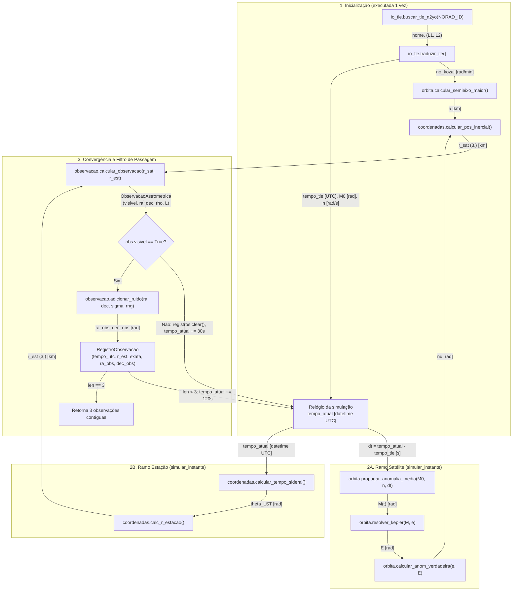

# 00.02 — Arquitetura e Análise Completa do Código

Documento vivo que explica a estrutura atual do código em `src/`, o fluxo de dados e unidades entre os módulos, a correspondência com a física e os pontos de atenção / bugs identificados.

**Documentos relacionados:** [[00.00 Mapa de Conteúdo]] · [[00.01 Referências de Estudo]]

---

## 1. Mapa de Arquivos e Responsabilidades

```text
astrometria-unifa/
├── data/                         # [Planejado] Cache local de TLEs (JSON/TXT)
├── docs/                         # Documentação de estudo no Obsidian
├── tests/                        # [Planejado] Testes unitários e físicos (pytest)
└── src/
    ├── main.py                   # Orquestrador da simulação
    └── astrometria/
        ├── __init__.py
        ├── constantes.py         # Parâmetros físicos, WGS84, Petrolina e NORAD ID
        ├── io_tle.py             # Fronteira externa: consulta N2YO e parser Skyfield
        ├── orbita.py             # Cinemática no plano orbital (a, M(t), E, nu)
        ├── coordenadas.py        # Rotações 3-1-3 (PQW -> ECI), tempo sideral e R_est
        ├── observacao.py         # Vetor rho, visibilidade, (RA, Dec) e ruído gaussiano
        ├── iod_gauss.py          # [Etapa 4] Método de Gauss (Algoritmo 50 do Vallado)
        └── ekf.py                # [Etapa 5] EKF cartesiano com perturbação J2
```

---

## 2. Fluxo de Dados e Unidades no Pipeline Atual

Regra do núcleo matemático: todas as grandezas entram convertidas em **`float` puro** nas unidades **$\text{km}$**, **$\text{s}$** e **$\text{rad}$**, e todos os vetores 3D são arrays NumPy de formato **`(3,)`**.



---

## 3. Análise Detalhada Módulo por Módulo

### 3.1 `constantes.py` — Parâmetros do Cenário e da Terra
Centraliza constantes imutáveis sem lógica executável:
- **Estação (Petrolina-PE):** `OBS_LATITUDE = -9.39` ($^\circ$), `OBS_LONGITUDE = -40.50` ($^\circ$), `OBS_ALTITUDE = 376` ($\text{m}$).
- **Alvo:** `NORAD_ID = 47699` (Amazônia-1).
- **Gravitação e WGS84:**
  - `MU_TERRA = 398600.4418` ($\text{km}^3/\text{s}^2$)
  - `SEMIEIXO_MAIOR_TERRA = 6378.137` ($\text{km}$)
  - `SEMIEIXO_MENOR_TERRA = 6356.752` ($\text{km}$)
  - `PRIMEIRA_EXC_QUAD_TERRA = 0.00669437999` ($e_\oplus^2 = 1 - b^2/a^2$)

---

### 3.2 `io_tle.py` — Fronteira de Entrada e TLEs
Isola I/O externo (rede, variáveis de ambiente e `skyfield`):
- **`traduzir_tle(name, tle) -> EarthSatellite`:** usa `skyfield.api.load.timescale()` e instancia `EarthSatellite`. O atributo `.model` (objeto `Satrec` da biblioteca `sgp4`) expõe os elementos médios em unidades prontas para astrodinâmica:
  - `model.no_kozai`: movimento médio em **$\text{rad/min}$** (atenção à unidade em minutos!).
  - `model.ecco`: excentricidade (adimensional).
  - `model.mo`: anomalia média na época $M_0$ ($\text{rad}$).
  - `model.nodeo`: ascensão reta do nodo ascendente $\Omega$ ($\text{rad}$).
  - `model.inclo`: inclinação $i$ ($\text{rad}$).
  - `model.argpo`: argumento do perigeu $\omega$ ($\text{rad}$).
- **`buscar_tle_n2yo(norad_id, api_key=None, timeout=15.0)`:** lê `N2YO_API_KEY` do ambiente, faz `requests.get`, valida HTTP (`raise_for_status`) e retorna `(satname, (linha1, linha2))`.
- **Pendência arquitetural:** ainda não faz cache local em `data/` para evitar chamadas repetidas à API.

---

### 3.3 `orbita.py` — Cinemática no Plano Orbital (2D)
Implementa a Etapa 1 do pipeline (veja [[21.01 Módulo 1 — Cinemática Orbital e Propagação Temporal]]):

1. **`calcular_semieixo_maior(movimento_medio_rad_min, mu=MU_TERRA) -> float`**
   - Converte $n$ de $\text{rad/min}$ para $\text{rad/s}$ (`movimento_medio_rad_min / 60.0`) e aplica $a = (\mu / n^2)^{1/3}$.
2. **`propagar_anomalia_media(anom_media, tempo_tle, tempo_instante, vel_ang_med) -> float`**
   - Calcula $\Delta t = (t - t_0)$ em segundos e retorna $(M_0 + n\Delta t) \bmod 2\pi$.
   - *Atenção:* veja na Seção 4 os problemas de assinatura e import morto nesta função.
3. **`resolver_kepler(M, e, tol=1e-10, max_iter=50) -> float`**
   - Parte de $E_0 = M$ e itera Newton-Raphson até $|\Delta E| < 10^{-10}\text{ rad}$, retornando a anomalia excêntrica $E$.
4. **`calcular_anom_verdadeira(e, E) -> float`**
   - Usa `np.arctan2(sqrt(1 - e²) * sin(E), cos(E) - e)` para converter $E \to \nu$ sem ambiguidade de quadrante.

---

### 3.4 `coordenadas.py` — Rotações 3D e Posição da Estação
Implementa a Etapa 2 do pipeline (veja [[22.01 Módulo 2 — Sistemas de Referência e Rotação Terrestre]]):

1. **`Rz(theta)` e `Rx(theta)`:**
   - Matrizes $3 \times 3$ ortogonais de rotação passiva (rotação de eixos) em torno de $Z$ e $X$.
2. **`calcular_pos_inercial(a, e, v, omega, i, w) -> np.ndarray`**
   - Calcula a distância focal $r = \frac{a(1 - e^2)}{1 + e\cos\nu}$ e o vetor perifocal $\mathbf{r}_{\text{PQW}} = [r\cos\nu,\, r\sin\nu,\, 0]$.
   - Aplica a rotação inversa $3\text{-}1\text{-}3$: $\mathbf{Q} = \mathbf{R}_z(-\Omega)\mathbf{R}_x(-i)\mathbf{R}_z(-\omega)$ e retorna $\mathbf{r}_{\text{ECI}} = \mathbf{Q}\mathbf{r}_{\text{PQW}}$ com formato `(3,)`.
3. **`calcular_tempo_sideral(tempo, latitude, longitude) -> float`**
   - Usa `astropy` (`EarthLocation` + `Time(...).sidereal_time("apparent")`) na fronteira de entrada para obter o Tempo Sideral Aparente Local ($\theta_{\text{LST}}$) em **radianos**.
4. **`calc_r_estacao(tempo, latitude, longitude, altitude_m) -> np.ndarray`**
   - Converte latitude para radianos e altitude para $\text{km}$, calcula o raio de curvatura na vertical primeira $N(\phi)$ (WGS84) e gira a estação pelo ângulo $\theta_{\text{LST}}$ para entregar $\mathbf{R}_{\text{est}}(t)$ em $\text{km}$ no formato `(3,)`.

**Nota física sobre referenciais:**
Os ângulos do TLE (`nodeo`, `inclo`, `argpo`) saem do SGP4 no referencial **TEME** (*True Equator, Mean Equinox*), enquanto `sidereal_time("apparent")` fornece o ângulo relativo ao equinócio verdadeiro da data (**TOD**). Ambos compartilham o mesmo plano equatorial verdadeiro da data, diferindo apenas pela *equação dos equinócios* ($\lesssim 18''$). Ao comparar contra o Skyfield no `tests/test_geometria.py`, lembre-se dessa distinção ao escolher o frame de referência do gabarito.

---

### 3.5 `observacao.py` — Geometria Óptica e Modelo de Ruído
Implementa a Etapa 3 do pipeline (veja [[23.01 Módulo 3 — Geometria de Observação Óptica]]):

1. **`ObservacaoAstrometrica` (`@dataclass(frozen=True)`):**
   - Agrupa `visivel: bool`, `ra: float`, `dec: float`, `vetor_topocentrico: np.ndarray` ($\boldsymbol{\rho}$) e `direcao: np.ndarray` ($\hat{\mathbf{L}}$).
2. **`calcular_observacao(r_sat, r_est) -> ObservacaoAstrometrica`:**
   - Puramente determinística (sem ruído), permitindo reuso direto na função de medição $\mathbf{h}(\mathbf{x})$ do futuro EKF.
   - Calcula $\boldsymbol{\rho} = \mathbf{r}_{\text{sat}} - \mathbf{r}_{\text{est}}$, normaliza $\hat{\mathbf{L}} = \boldsymbol{\rho}/\Vert\boldsymbol{\rho}\Vert$, verifica horizonte ($\mathbf{R}_{\text{est}} \cdot \boldsymbol{\rho} > 0$), extrai $\delta = \arcsin(L_z)$ e $\alpha = \text{arctan2}(L_y, L_x) \in [0, 2\pi)$.
3. **`adicionar_ruido(ra, dec, sigma_arcsec, rng=None) -> tuple[float, float]`:**
   - Converte $\sigma$ de arcosegundos para radianos ($\sigma_{\text{rad}} = \text{rad}(\sigma'' / 3600)$).
   - Aplica ruído isotrópico na esfera celeste: $\mathcal{N}(0, \sigma_{\text{rad}}^2)$ em $\delta$ e $\mathcal{N}(0, (\sigma_{\text{rad}}/\cos\delta)^2)$ em $\alpha$ (compensando o estreitamento dos meridianos perto dos polos).
   - Normaliza $\alpha \in [0, 2\pi)$ e limita $\delta \in [-\pi/2, \pi/2]$.

---

## 4. Diagnóstico do Estado Atual (Resolvido vs. Pendências)

### O que já está funcionando
- `src/main.py` executa de ponta a ponta: consulta o TLE, propaga em passos de 30 s dentro de uma janela de 24h, isola uma passagem contínua sobre Petrolina e extrai 3 instantes espaçados de 120 s em `RegistroObservacao` (já com suporte a `adicionar_ruido`).
- `orbita.py`, `coordenadas.py` e `observacao.py` operam exclusivamente com `float` puro (`km`, `s`, `rad`) e vetores `np.ndarray` de formato `(3,)`.

### Pendências para os próximos passos
1. **Validação física e testes (`tests/`):** criar `test_kepler.py` e `test_geometria.py` com `pytest` comparando contra o gabarito do Skyfield.
2. **Cache local de TLE em `data/` (`io_tle.py`):** salvar o TLE em JSON/TXT para evitar depender da API N2YO em toda execução.
3. **Módulo 4 (`iod_gauss.py`):** implementar o Método de Gauss (Algoritmo 50 do Vallado) usando os 3 `RegistroObservacao` gerados pela `main.py`.
4. **Módulo 5 (`ekf.py`):** implementar o EKF cartesiano com perturbação $J_2$ e atualização por `(RA, Dec)`.
